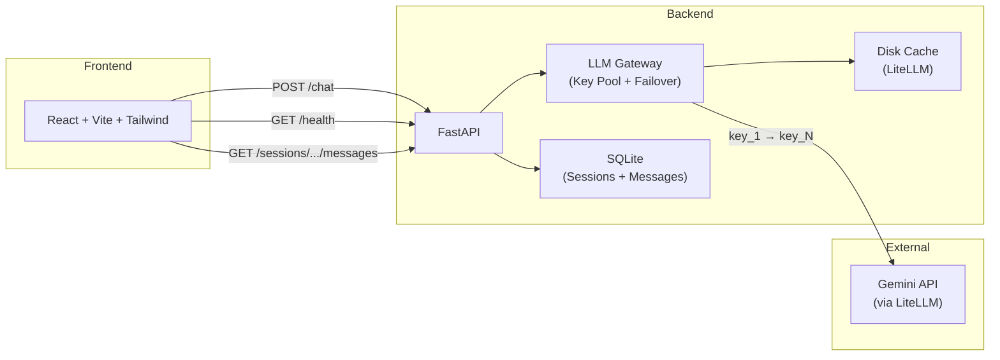

# LLM Chatbot with Multi-Turn Memory, Key Failover & Caching

A production-ready LLM chatbot with multi-turn conversation memory, an API-key pool with automatic failover, and response caching — built with React, FastAPI, LiteLLM, and SQLite.



---

### Live URLs

| Service  | URL |
|----------|-----|
| Frontend (Vercel) | [https://ai-assignment-uobr.vercel.app](https://ai-assignment-uobr.vercel.app) |
| Backend (Render)  | [https://llm-chatbot-backend-xgox.onrender.com](https://llm-chatbot-backend-xgox.onrender.com) |

---

### Run locally: with Docker and without

#### With Docker (recommended)

```bash
# 1. Clone the repo
git clone https://github.com/suyashtripathi656/Lyftr-AI-Assignment.git && cd Lyftr-AI-Assignment

# 2. Create .env from the template
cp .env.example .env
# Edit .env and add your real API keys (at least 2):
#   LLM_API_KEYS=key1,key2

# 3. Start everything
make up

# Frontend: http://localhost:3000
# Backend:  http://localhost:8000
# Health:   http://localhost:8000/health

# View logs
make logs

# Stop
make down
```

#### Without Docker

```bash
# Backend
cd backend
python -m venv venv && source venv/bin/activate  # Windows: venv\Scripts\activate
pip install -r requirements.txt
export LLM_API_KEYS="key1,key2"  # Windows: set LLM_API_KEYS=key1,key2
export ENABLE_FAILURE_SIMULATION=true
export DATABASE_URL="sqlite:///./data/app.db"
export CACHE_DIR="./data/cache"
export ALLOWED_ORIGINS="http://localhost:3000"
uvicorn app.main:app --reload --port 8000

# Frontend (new terminal)
cd frontend
npm install
echo "VITE_API_URL=http://localhost:8000" > .env
npm run dev
```

---

### Design decisions: key fallback, caching, SQLite session storage

#### Key fallback (explicit loop vs. Router)

We use an **explicit ordered loop** over API keys instead of LiteLLM's Router for these reasons:

1. **Exact control over `key_id` and `fallback_attempts`** — the contract requires reporting which key answered and how many failed before it. The Router abstracts this away.
2. **Simulation hook integration** — the failure simulation header (`X-Simulate-Failure`) must inject errors *per key, inside the loop, before calling the provider*. This is impossible with the Router's internal retry logic.
3. **Deterministic order** — the contract specifies key_1 is always tried first, in order. The Router may use load-balancing strategies.

LiteLLM still handles the actual provider calls, timeout, and caching — we only control the outer retry loop.

#### Caching

LiteLLM's built-in disk cache (`diskcache`) stores responses keyed by model + messages. We generate a **custom cache key** as `sha256(model + canonical JSON of messages)` to guarantee:
- **api_key is excluded** — a cache hit works regardless of which key originally answered.
- **model and messages are included** — different models or different conversation histories never collide.
- **Same first message in a new session hits** — because the message list (system + user message) is identical.

#### Cache bypass on simulation

When `X-Simulate-Failure` is present and active, we **bypass the cache READ**. This ensures failover tests are deterministic even if the prompt was cached by a previous request. The surviving key produces a fresh `LIVE_INFERENCE` result.

#### SQLite session storage

SQLite with WAL mode provides:
- Simple single-file deployment (persisted on a Docker volume or Render disk)
- ACID transactions — user and assistant messages are saved in a single transaction only after a successful LLM response
- Good read concurrency via WAL
- No external database dependency

---

### API Contract Summary

| Method | Path | Success | Error |
|--------|------|---------|-------|
| `GET` | `/health` | `200 {"status":"ok","keys_configured":int,"cache_enabled":true}` | `503 {"detail":"..."}` |
| `POST` | `/chat` | `200 {"session_id","reply","metadata":{...}}` | `422`, `503` |
| `GET` | `/sessions/{session_id}/messages` | `200 {"session_id","messages":[...]}` | `404 {"detail":"session not found"}` |

**Chat metadata fields:** `resolution_source` (LIVE_INFERENCE / LLM_CACHE), `model`, `latency_ms`, `input_tokens`, `output_tokens`, `key_id` (null on cache hit), `fallback_attempts`.

---

### Verification: how to see failover, cache hits and per-message token usage

#### Health check
```bash
curl http://localhost:8000/health | python3 -m json.tool
```

#### Normal chat
```bash
curl -X POST http://localhost:8000/chat \
  -H "Content-Type: application/json" \
  -d '{"session_id":"test-1","message":"What is 2+2?"}'
```

#### Cache hit (send same first message in a new session)
```bash
curl -X POST http://localhost:8000/chat \
  -H "Content-Type: application/json" \
  -d '{"session_id":"test-2","message":"What is 2+2?"}'
# → resolution_source should be "LLM_CACHE"
```

#### Failover: key_1=429
```bash
curl -X POST http://localhost:8000/chat \
  -H "Content-Type: application/json" \
  -H "X-Simulate-Failure: key_1=429" \
  -d '{"session_id":"fo-1","message":"hello"}'
# → key_id: "key_2", fallback_attempts: 1
```

#### Failover: key_1=500
```bash
curl -X POST http://localhost:8000/chat \
  -H "Content-Type: application/json" \
  -H "X-Simulate-Failure: key_1=500" \
  -d '{"session_id":"fo-2","message":"hello"}'
# → key_id: "key_2", fallback_attempts: 1
```

#### Failover: all keys fail
```bash
curl -X POST http://localhost:8000/chat \
  -H "Content-Type: application/json" \
  -H "X-Simulate-Failure: *=429" \
  -d '{"session_id":"fo-3","message":"hello"}'
# → 503 {"detail":"all providers unavailable"}
```

#### Validation (422)
```bash
# Empty message
curl -X POST http://localhost:8000/chat \
  -H "Content-Type: application/json" \
  -d '{"session_id":"v1","message":""}'

# Missing session_id
curl -X POST http://localhost:8000/chat \
  -H "Content-Type: application/json" \
  -d '{"message":"hi"}'

# Malformed JSON
curl -X POST http://localhost:8000/chat \
  -H "Content-Type: application/json" \
  -d 'not json'
```

#### History (404)
```bash
curl http://localhost:8000/sessions/nonexistent/messages
# → 404 {"detail":"session not found"}
```

#### UI verification
1. Open http://localhost:3000
2. Check `data-testid` values: `chat-input`, `send-button`, `assistant-message`, `meta-source`, `meta-model`, `meta-latency`, `meta-input-tokens`, `meta-output-tokens`, `system-prompt-input`
3. Send a message → verify metadata badge (blue = LIVE_INFERENCE)
4. Open "New chat" → send the exact same message → verify green LLM_CACHE badge
5. Open "Test tools" panel → select `key_1=429` → send a message → verify key_2 and fallback info

---

### Setup Used: your editor and AI tools

- **Antigravity** — AI coding assistant for project scaffolding and implementation
- **LiteLLM** — Unified LLM gateway with multi-provider support and disk caching
- **Gemini 2.0 Flash** — Default LLM model (via Google AI)
- **FastAPI** — High-performance async Python web framework
- **React + Vite + TypeScript + Tailwind CSS** — Frontend stack
- **SQLite** — Lightweight embedded database with WAL mode
- **Docker + Docker Compose** — Containerisation and orchestration

---

### Bonus features (if any): what you added beyond the requirements and why

| Feature | Why |
|---------|-----|
| **Test tools panel** | Collapsible UI panel with failure simulation selector and system prompt input — lets you demo failover without curl |
| **Typing indicator** | Animated bouncing dots while waiting for the LLM response |
| **Colour-coded source badges** | Green for cache hits, blue for live inference — instant visual feedback |
| **Key ID and fallback display** | Shows which key answered and how many fallbacks occurred, per message |
| **Backend cold-start handling** | Polls /health and shows "waking up server..." until ready |
| **Error boundary** | React error boundary prevents blank screens on crashes |
| **Responsive design** | Works on mobile and desktop |
| **System prompt per session** | Optional system prompt override via the UI |
| **Smoke test script** | Automated end-to-end contract verification (`make smoke-test` or `bash backend/scripts/smoke_test.sh`) |
